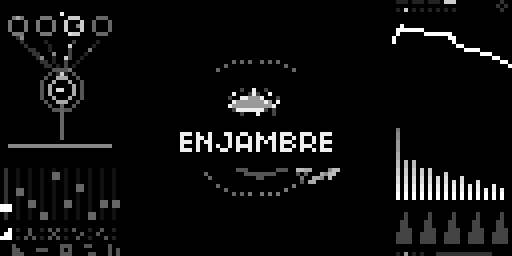

[English](README.md) · [Español](README.es.md) · [Français](README.fr.md) · **Deutsch** · [日本語](README.ja.md) · [中文](README.zh.md) · [हिन्दी](README.hi.md)

# Chordex Filo

Der kaputte Bruder der Chordex-Familie: ein **monophoner Lo-Fi-Synth** für
[monome norns](https://monome.org/docs/norns/). Eine einzige Stimme und eine
**Wolke aus Grains**, die sie aus dem Gedächtnis wiederholt. Im Akkordmodus
wählt jedes Grain einen Ton des Akkords: eine Stimme, die wie ein zerlegter
Akkord klingt. Kaputt, tief und schmutzig, mit 4 Bänken × 8 Presets, also
32 Sounds. Statt eines Arpeggiators gibt es **FALLA** (Störung): Solange K2
gedrückt ist, geht etwas kaputt.


**Der Bildschirm ist der Klang:**

- **links:** die Stimme. OSC, SUB, NUBE (Wolke) und POLVO (Staub) sind
  Kreise, deren Helligkeit ihrem Pegel entspricht; sie schicken Partikel in
  das Filter. Der Punkt im Filter ist der Cutoff, der Ring die Resonanz.
  Darunter die 10 Fader.
- **Mitte:** der Punktring ist das Gedächtnis (was gerade erklang, leuchtet),
  der Strich markiert die Gegenwart und die Bögen sind die Grains: weiter
  außen = höher. Innen die trockene Wellenform und der Akkord auf dem
  12-Ton-Rad. Mit ROTO wird alles stufig und flackert.
- **rechts:** Bank und Preset, Oszilloskop, Spektrum und die Störung,
  animiert, solange K2 gedrückt ist.

## Eigenschaften

- **mono**: die letzte Note gewinnt. Bei Legato gleitet die Stimme, ohne neu
  anzuschlagen
- **4 Bänke × 8 Presets**
  - **ROTO** (kaputt): MODEM, GLITCH, 8 BITS, CD RAYADO, CORTO, ESQUIRLAS,
    FALLA, SIERRA
  - **ABISMO** (Abgrund): FOSA, SUBSUELO, CALDERA, BALLENA, TUNEL, LODO,
    DRONE, ECLIPSE
  - **CINTA** (Band): VHS, CASETE, WALKMAN, BOBINA, DICTAFONO, RADIO AM,
    DERRETIDO, TECLADO
  - **NUBE** (Wolke): NIEBLA, ENJAMBRE, LLOVIZNA, MAREA, ESPEJO, CORO ROTO,
    CENIZA, AURORA
- **Stimme**: ein Oszillator von Sägezahn bis Puls, Sub, Bandsättigung und
  Wow, resonantes Filter mit Hüllkurve, Glide
- **Wolke**: die Stimme wird ständig in einen 5-Sekunden-Speicher
  aufgenommen, aus dem die Grains lesen. Größe, Dichte, Gedächtnis (wie weit
  sie zurückgreifen) und Chaos (Oktaven, rückwärts laufende Grains,
  Unordnung, Panorama)
- **Akkordmodus**: jedes Grain wählt einen der vier Akkordtöne.
  **10 Akkorde**: maj, min, dim, aug, 7, maj7, min7, m7b5, sus2, sus4
- **FALLA** (K2 halten), temposynchron, 4 Typen:
  - **CAIDA** (Sturz): das Band bremst ab, die Tonhöhe sackt weg und
    verstummt
  - **TARTAMUDEO** (Stottern): der Tonkopf bleibt stehen und wiederholt das
    letzte Stückchen
  - **MORDIDA** (Biss): maximal kaputt, mit temposynchronen Aussetzern
  - **POZO** (Schacht): eine Oktave tiefer, das Filter schließt sich und der
    Hall öffnet sich
- **roto**: weniger Samples, weniger Bits und Aussetzer. **polvo**: Rauschen,
  Knistern, Brummen und Höhenverlust, die dem Klang folgen
- **Effekte**: temposynchrones Bandecho und dunkler Hall
- **Halten** (K1)
- folgt der eingehenden MIDI-Clock für das Tempo von Störung und Echo
- alles wird automatisch gespeichert

<!-- u-ma:family -->
## Die Chordex-Familie

Gleiche Bedienung, andere Engines. Probier die anderen aus:

| | |
|---|---|
| <a href="https://github.com/buenosairesfront/chordex80/blob/main/README.de.md"></a> | **[Chordex 80](https://github.com/buenosairesfront/chordex80/blob/main/README.de.md)**<br>80er-Polysynth mit Outrun-Sonnenuntergang<br>`;install https://github.com/buenosairesfront/chordex80` |
| <a href="https://github.com/buenosairesfront/chordexfm/blob/main/README.de.md"></a> | **[Chordex FM](https://github.com/buenosairesfront/chordexfm/blob/main/README.de.md)**<br>FM mit 4 Operatoren, als Blume gezeichnet<br>`;install https://github.com/buenosairesfront/chordexfm` |
| <a href="https://github.com/buenosairesfront/chordexstg/blob/main/README.de.md"></a> | **[ChordexSTG](https://github.com/buenosairesfront/chordexstg/blob/main/README.de.md)**<br>Orchesterstreicher mit echter Bewegung einer gestrichenen Saite<br>`;install https://github.com/buenosairesfront/chordexstg` |
| <a href="https://github.com/buenosairesfront/chordexwt/blob/main/README.de.md"></a> | **[Chordex WT](https://github.com/buenosairesfront/chordexwt/blob/main/README.de.md)**<br>Wavetable: 8 Bänke mit je 8 Wellen, als 3D-Tabelle gezeichnet<br>`;install https://github.com/buenosairesfront/chordexwt` |
| <a href="https://github.com/buenosairesfront/chordexchip/blob/main/README.de.md"></a> | **[Chordex CHIP](https://github.com/buenosairesfront/chordexchip/blob/main/README.de.md)**<br>Chiptune: 8 Konsolenchips × 8 Presets, als Tracker gezeichnet<br>`;install https://github.com/buenosairesfront/chordexchip` |
| <a href="https://github.com/buenosairesfront/chordexabnt/blob/main/README.de.md"></a> | **[Chordex ABNT](https://github.com/buenosairesfront/chordexabnt/blob/main/README.de.md)**<br>Pads, Ambient, Leads und Texturen: 4 Familien × 8 Presets, mit BEWEGUNG statt Arpeggiator<br>`;install https://github.com/buenosairesfront/chordexabnt` |

**Mehr von U-MA:** alle Instrumente und Werkzeuge an einem Ort → [U-MA-Übersicht](https://github.com/buenosairesfront/U-ma/blob/main/README.de.md)
<!-- /u-ma:family -->

## Voraussetzungen

- norns (shield, standard oder fates)
- ein MIDI-Keyboard oder -Controller

## Installation

In maiden:

```
;install https://github.com/buenosairesfront/chordexfilo
```

Danach **norns neu starten** (SYSTEM > RESTART), damit die neue Engine `Filo`
kompiliert wird, und **chordexfilo** über SELECT laden.

## Bedienung

| Bedienelement | Aktion |
|---|---|
| E1 | Cutoff (Helligkeit) |
| E2 | Fader wählen (der Name erscheint kurz) |
| E3 | Fader einstellen |
| K3 + E1 | Preset (alle 32 in einer Reihe: ROTO 1–8, ABISMO, CINTA, NUBE) |
| K3 + E2 | Hall |
| K3 + E3 | Akkordtyp |
| K3 halten (ohne zu drehen) | Akkordmodus an/aus |
| K2 halten | Störung (dauert, solange gedrückt) |
| K2 + E1 | Tiefe der Störung |
| K2 + E2 | Typ der Störung |
| K2 + E3 | Geschwindigkeit der Störung (1/2 bis 1/32) |
| K1 halten | Halten an/aus (Raute oben rechts) |

**Fader:** Attack, Release, Resonanz, Grain-Größe, Dichte, Gedächtnis, Chaos,
roto (kaputt), polvo (Staub), Echo.

**PARAMETERS-Menü:** MIDI-Kanal (Standard 1; 0 = alle), Bank, Preset, Form
(Sägezahn–Puls), Sub, Glide, Oktave, Wow, Sättigung, Wolke (trocken–Grains),
Decay, Sustain, Filterhüllkurve, Echo-Wiederholungen und -Zeit, Lautstärke
sowie alles oben Genannte.

## arc und crow

Beide sind optional: ohne angeschlossenes arc oder crow ändert sich nichts.

**arc** (4 Ringe, als Drehregler gezeichnet): 1 Cutoff · 2 Grain-Größe · 3 Tiefe der Störung · 4 Hall

**crow**: IN1 = Tonhöhe (V/Okt, 0 V = C4), IN2 = Gate (spielt und lässt los) · OUT1 = die Note (V/Okt) · OUT2 = Hüllkurve (0–8 V, mit Attack und Release des Klangs) · OUT3 = temposynchroner LFO · OUT4 = ein Impuls bei jeder Note. Abschaltbar unter PARAMETERS > ARC / CROW.

**Tempo:** beim ersten Start steht das interne Tempo auf 50 BPM. Kommt MIDI-Clock an (über einen beliebigen MIDI-Port), übernimmt sie.

## Galerie

| | |
|---|---|
|  ROTO · MODEM · maj7 |  ABISMO · FOSA · min7 |
|  CINTA · VHS · maj7 |  NUBE · NIEBLA · min |
|  Störung TARTAMUDEO (K2 gehalten) |  Preset-Auswahl (K3 + E1) |

## Credits

Von [Buenos Aires Front](https://github.com/buenosairesfront) / U-MA.
Veröffentlicht unter der MIT-Lizenz.
