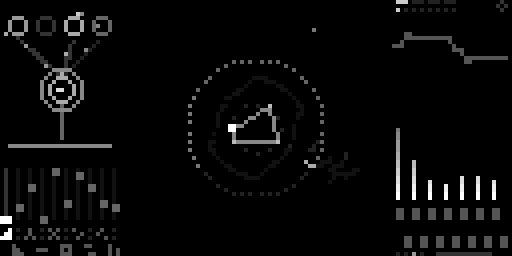
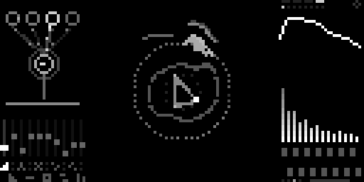

[English](README.md) · **Español** · [Français](README.fr.md) · [Deutsch](README.de.md) · [日本語](README.ja.md) · [中文](README.zh.md) · [हिन्दी](README.hi.md)

# Chordex Filo

El hermano roto de la familia Chordex: un sinte **monofónico lo-fi** para
[monome norns](https://monome.org/docs/norns/). Una sola voz y una **nube de
granos** que la repite desde la memoria. Con el modo acorde cada grano elige
un tono del acorde: una voz que suena a acorde desarmado. Roto, profundo y
sucio, con 4 bancos × 8 presets, 32 sonidos. En lugar de arpegiador tiene
**FALLA**: mientras apretás K2, algo se rompe.


**La pantalla es el sonido:**

- **izquierda:** la voz. OSC, SUB, NUBE y POLVO son círculos que brillan
  según su nivel y mandan partículas al filtro. El punto adentro del filtro
  es el cutoff y el anillo es la resonancia. Abajo, los 10 faders.
- **centro:** el anillo de puntos es la memoria (brilla lo que sonó), la raya
  marca el presente y los arcos son los granos: más afuera, más agudo.
  Adentro, la onda seca y el acorde en la rueda de 12 notas. Con ROTO todo se
  escalona y parpadea.
- **derecha:** banco y preset, osciloscopio, espectro y la falla, animada
  mientras K2 está apretado.

## Características

- **mono**: manda la última nota. Tocando ligado la voz se desliza (glide)
  sin reatacar
- **4 bancos × 8 presets**
  - **ROTO**: MODEM, GLITCH, 8 BITS, CD RAYADO, CORTO, ESQUIRLAS, FALLA, SIERRA
  - **ABISMO**: FOSA, SUBSUELO, CALDERA, BALLENA, TUNEL, LODO, DRONE, ECLIPSE
  - **CINTA**: VHS, CASETE, WALKMAN, BOBINA, DICTAFONO, RADIO AM, DERRETIDO,
    TECLADO
  - **NUBE**: NIEBLA, ENJAMBRE, LLOVIZNA, MAREA, ESPEJO, CORO ROTO, CENIZA,
    AURORA
- **voz**: un oscilador que va de sierra a pulso, sub, saturación y wow de
  cinta, filtro resonante con envolvente, glide
- **nube**: la voz se graba todo el tiempo en una memoria de 5 segundos y los
  granos la leen. Tamaño, densidad, memoria (cuánto para atrás buscan) y caos
  (octavas, granos al revés, desorden, panorama)
- **modo acorde**: cada grano elige uno de los cuatro tonos del acorde.
  **10 acordes**: maj, min, dim, aug, 7, maj7, min7, m7b5, sus2, sus4
- **FALLA** (K2 mantenido), a tempo, 4 tipos:
  - **CAIDA**: la cinta se frena, la afinación se desploma y se apaga
  - **TARTAMUDEO**: el cabezal se detiene y repite el último pedacito
  - **MORDIDA**: roto al máximo, con cortes a tempo
  - **POZO**: una octava abajo, se cierra el filtro y se abre el hall
- **roto**: menos muestras, menos bits y cortes. **polvo**: soplido, crackle,
  zumbido y pérdida de agudos, que siguen al sonido
- **efectos**: eco de cinta a tempo y hall oscuro
- **retener** (K1)
- sigue el reloj MIDI entrante para el tempo de la falla y del eco
- todo se guarda solo

<!-- u-ma:family -->
## La familia Chordex

Mismos controles, motores distintos. Probá los otros:

| | |
|---|---|
| <a href="https://github.com/buenosairesfront/chordex80/blob/main/README.es.md"></a> | **[Chordex 80](https://github.com/buenosairesfront/chordex80/blob/main/README.es.md)**<br>polisynth ochentoso con atardecer outrun<br>`;install https://github.com/buenosairesfront/chordex80` |
| <a href="https://github.com/buenosairesfront/chordexfm/blob/main/README.es.md"></a> | **[Chordex FM](https://github.com/buenosairesfront/chordexfm/blob/main/README.es.md)**<br>FM de 4 operadores, dibujado como una flor<br>`;install https://github.com/buenosairesfront/chordexfm` |
| <a href="https://github.com/buenosairesfront/chordexstg/blob/main/README.es.md"></a> | **[ChordexSTG](https://github.com/buenosairesfront/chordexstg/blob/main/README.es.md)**<br>cuerdas de orquesta con el movimiento real de una cuerda frotada<br>`;install https://github.com/buenosairesfront/chordexstg` |
| <a href="https://github.com/buenosairesfront/chordexwt/blob/main/README.es.md"></a> | **[Chordex WT](https://github.com/buenosairesfront/chordexwt/blob/main/README.es.md)**<br>wavetable: 8 bancos de 8 ondas, dibujado como una tabla en 3D<br>`;install https://github.com/buenosairesfront/chordexwt` |
| <a href="https://github.com/buenosairesfront/chordexchip/blob/main/README.es.md"></a> | **[Chordex CHIP](https://github.com/buenosairesfront/chordexchip/blob/main/README.es.md)**<br>chiptune: 8 chips de consola × 8 presets, dibujado como un tracker<br>`;install https://github.com/buenosairesfront/chordexchip` |
| <a href="https://github.com/buenosairesfront/chordexabnt/blob/main/README.es.md"></a> | **[Chordex ABNT](https://github.com/buenosairesfront/chordexabnt/blob/main/README.es.md)**<br>pads, ambient, leads y texturas: 4 familias × 8 presets, con MOVIMIENTO en lugar de arpegiador<br>`;install https://github.com/buenosairesfront/chordexabnt` |

**Más de U-MA:** todos los instrumentos y herramientas en un solo lugar → [muestrario U-MA](https://github.com/buenosairesfront/U-ma/blob/main/README.es.md)
<!-- /u-ma:family -->

## Requisitos

- norns (shield, standard o fates)
- un teclado o controlador MIDI

## Instalación

Desde maiden:

```
;install https://github.com/buenosairesfront/chordexfilo
```

Después **reiniciá la norns** (SYSTEM > RESTART) para que se compile el engine
nuevo `Filo`, y cargá **chordexfilo** desde SELECT.

## Controles

| control | acción |
|---|---|
| E1 | cutoff (brillo) |
| E2 | elige fader (muestra su nombre un momento) |
| E3 | ajusta fader |
| K3 + E1 | preset (los 32 en fila: ROTO 1–8, ABISMO, CINTA, NUBE) |
| K3 + E2 | hall |
| K3 + E3 | tipo de acorde |
| K3 mantenido (sin girar) | modo acorde on/off |
| K2 mantenido | falla (dura mientras se aprieta) |
| K2 + E1 | profundidad de la falla |
| K2 + E2 | tipo de falla |
| K2 + E3 | velocidad de la falla (1/2 a 1/32) |
| K1 mantenido | retener on/off (rombo arriba a la derecha) |

**Faders:** ataque, release, resonancia, tamaño del grano, densidad, memoria,
caos, roto, polvo, eco.

**Menú PARAMETERS:** canal MIDI (1 por defecto; 0 = todos), banco, preset,
forma (sierra–pulso), sub, glide, octava, wow, saturación, nube
(seco–granos), decay, sustain, envolvente del filtro, repeticiones y tiempo
del eco, volumen, y todo lo anterior.

## arc y crow

Los dos son opcionales: sin arc ni crow conectados no cambia nada.

**arc** (4 anillos, dibujados como perillas): 1 cutoff · 2 tamaño del grano · 3 profundidad de la falla · 4 hall

**crow**: IN1 = altura (V/oct, 0 V = C4), IN2 = gate (toca y suelta) · OUT1 = la nota (V/oct) · OUT2 = envolvente (0–8 V, con el ataque y el release del sonido) · OUT3 = LFO a tempo · OUT4 = un pulso en cada nota. Se puede apagar en PARAMETERS > ARC / CROW.

**Tempo:** la primera vez arranca con el tempo interno en 50 BPM. Si entra reloj MIDI (por cualquier puerto MIDI), manda él.

## Galería

| | |
|---|---|
|  ROTO · MODEM · maj7 |  ABISMO · FOSA · min7 |
|  CINTA · VHS · maj7 |  NUBE · NIEBLA · min |
|  falla TARTAMUDEO (K2 mantenido) |  eligiendo preset (K3 + E1) |

## Créditos

Hecho por [Buenos Aires Front](https://github.com/buenosairesfront) / U-MA.
Publicado con licencia MIT.
