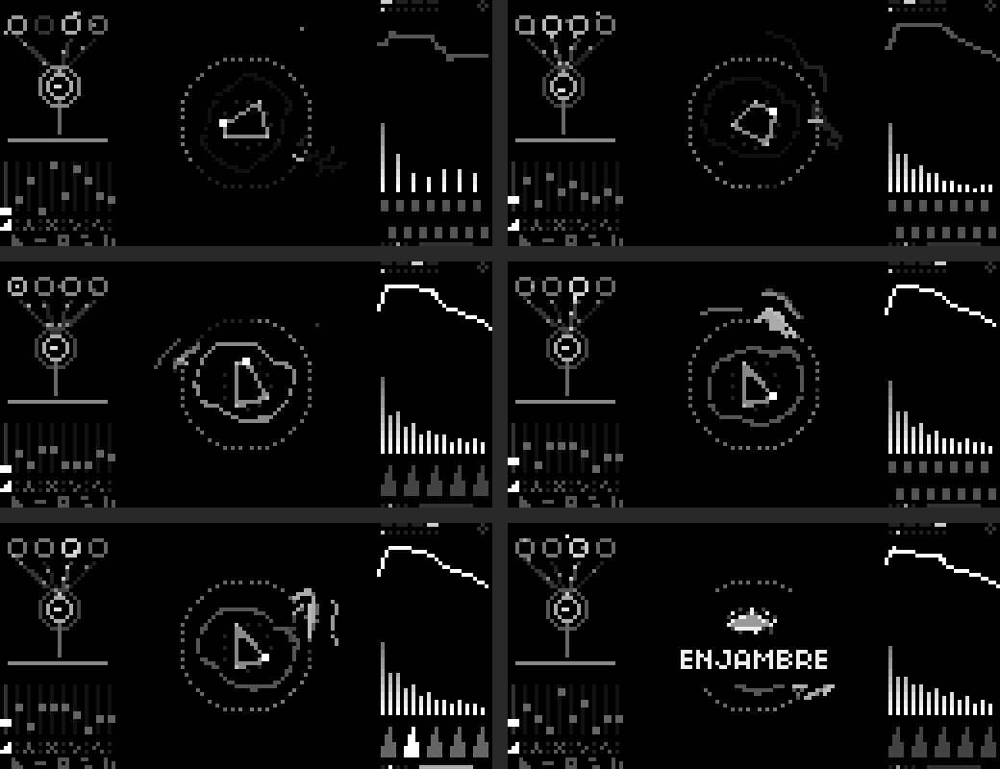
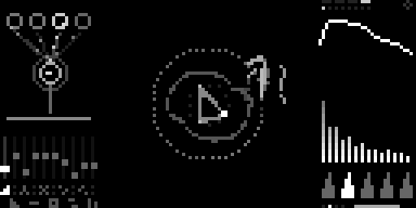

[English](README.md) · [Español](README.es.md) · [Français](README.fr.md) · [Deutsch](README.de.md) · [日本語](README.ja.md) · [中文](README.zh.md) · **हिन्दी**

# Chordex Filo

Chordex परिवार का टूटा हुआ भाई:
[monome norns](https://monome.org/docs/norns/) के लिए एक **मोनोफ़ोनिक lo-fi**
सिंथ। सिर्फ़ एक आवाज़, और **ग्रेन का एक बादल** जो उसे याददाश्त से दोहराता
रहता है। कॉर्ड मोड में हर ग्रेन कॉर्ड का एक स्वर चुनता है: एक ही आवाज़ जो
बिखरे हुए कॉर्ड जैसी सुनाई देती है। टूटी, गहरी और गंदी ध्वनि, 4 बैंक ×
8 प्रीसेट, यानी 32 ध्वनियाँ। आर्पेजिएटर की जगह इसमें **FALLA** (ख़राबी) है:
जब तक K2 दबा है, कुछ न कुछ टूटता है।



**स्क्रीन ही ध्वनि है:**

- **बाएँ:** आवाज़। OSC, SUB, NUBE (बादल) और POLVO (धूल) गोले हैं जिनकी चमक
  उनके स्तर के बराबर है; ये फ़िल्टर की ओर कण भेजते हैं। फ़िल्टर के अंदर का
  बिंदु कटऑफ़ है और छल्ला रेज़ोनेंस। नीचे 10 फ़ेडर।
- **बीच में:** बिंदुओं का छल्ला याददाश्त है (जो अभी बजा वह चमकता है), रेखा
  वर्तमान दिखाती है और चाप ग्रेन हैं: जितना बाहर, उतना ऊँचा स्वर। अंदर सूखी
  वेवफ़ॉर्म और 12 स्वरों के चक्र पर कॉर्ड। ROTO बढ़ाने पर सब कुछ सीढ़ीदार
  होकर टिमटिमाने लगता है।
- **दाएँ:** बैंक और प्रीसेट, ऑसिलोस्कोप, स्पेक्ट्रम और ख़राबी, जो K2 दबे
  रहने तक चलती रहती है।

## विशेषताएँ

- **मोनो**: आख़िरी स्वर को प्राथमिकता। लेगाटो बजाने पर आवाज़ दोबारा अटैक
  किए बिना फिसलती है (ग्लाइड)
- **4 बैंक × 8 प्रीसेट**
  - **ROTO** (टूटा): MODEM, GLITCH, 8 BITS, CD RAYADO, CORTO, ESQUIRLAS,
    FALLA, SIERRA
  - **ABISMO** (खाई): FOSA, SUBSUELO, CALDERA, BALLENA, TUNEL, LODO, DRONE,
    ECLIPSE
  - **CINTA** (टेप): VHS, CASETE, WALKMAN, BOBINA, DICTAFONO, RADIO AM,
    DERRETIDO, TECLADO
  - **NUBE** (बादल): NIEBLA, ENJAMBRE, LLOVIZNA, MAREA, ESPEJO, CORO ROTO,
    CENIZA, AURORA
- **आवाज़**: सॉ से पल्स तक जाने वाला एक ऑसिलेटर, सब, टेप सैचुरेशन और वाओ,
  एनवेलप वाला रेज़ोनेंट फ़िल्टर, ग्लाइड
- **बादल**: आवाज़ लगातार 5 सेकंड की याददाश्त में रिकॉर्ड होती रहती है और
  ग्रेन उसी से पढ़ते हैं। आकार, घनत्व, याददाश्त (कितना पीछे तक जाते हैं) और
  अराजकता (ऑक्टेव, उल्टे ग्रेन, बेतरतीबी, पैन)
- **कॉर्ड मोड**: हर ग्रेन कॉर्ड के चार स्वरों में से एक चुनता है।
  **10 कॉर्ड**: maj, min, dim, aug, 7, maj7, min7, m7b5, sus2, sus4
- **FALLA** (K2 दबाए रखें), टेम्पो के साथ, 4 प्रकार:
  - **CAIDA** (गिरावट): टेप धीमा पड़ता है, सुर ढह जाता है और आवाज़ बुझ
    जाती है
  - **TARTAMUDEO** (हकलाहट): हेड रुक जाता है और आख़िरी छोटा टुकड़ा दोहराता है
  - **MORDIDA** (काट): पूरी तरह टूटी ध्वनि, टेम्पो पर कटती हुई
  - **POZO** (कुआँ): एक ऑक्टेव नीचे, फ़िल्टर बंद होता है और हॉल खुल जाता है
- **roto**: कम सैंपल, कम बिट और कटाव। **polvo**: सरसराहट, क्रैकल, गुनगुनाहट
  और ऊँची आवृत्तियों का घटना, सब ध्वनि के साथ चलते हैं
- **इफ़ेक्ट**: टेम्पो के साथ चलने वाला टेप इको और गहरा हॉल
- **होल्ड** (K1)
- ख़राबी और इको का टेम्पो आने वाले MIDI क्लॉक का अनुसरण करता है
- सब कुछ अपने आप सेव होता है

<!-- u-ma:family -->
## Chordex परिवार

कंट्रोल वही, इंजन अलग। बाकी भी आज़माएँ:

| | |
|---|---|
| <a href="https://github.com/buenosairesfront/chordex80/blob/main/README.hi.md"></a> | **[Chordex 80](https://github.com/buenosairesfront/chordex80/blob/main/README.hi.md)**<br>outrun सूर्यास्त वाला 80 के दशक का पॉलीसिंथ<br>`;install https://github.com/buenosairesfront/chordex80` |
| <a href="https://github.com/buenosairesfront/chordexfm/blob/main/README.hi.md"></a> | **[Chordex FM](https://github.com/buenosairesfront/chordexfm/blob/main/README.hi.md)**<br>4-ऑपरेटर FM, फूल के रूप में<br>`;install https://github.com/buenosairesfront/chordexfm` |
| <a href="https://github.com/buenosairesfront/chordexstg/blob/main/README.hi.md"></a> | **[ChordexSTG](https://github.com/buenosairesfront/chordexstg/blob/main/README.hi.md)**<br>गज़ से बजे तार की असली गति वाले ऑर्केस्ट्रा स्ट्रिंग्स<br>`;install https://github.com/buenosairesfront/chordexstg` |
| <a href="https://github.com/buenosairesfront/chordexwt/blob/main/README.hi.md"></a> | **[Chordex WT](https://github.com/buenosairesfront/chordexwt/blob/main/README.hi.md)**<br>वेवटेबल: 8 वेव वाले 8 बैंक, 3D टेबल के रूप में<br>`;install https://github.com/buenosairesfront/chordexwt` |
| <a href="https://github.com/buenosairesfront/chordexchip/blob/main/README.hi.md"></a> | **[Chordex CHIP](https://github.com/buenosairesfront/chordexchip/blob/main/README.hi.md)**<br>चिपट्यून: 8 कंसोल चिप × 8 प्रीसेट, ट्रैकर के रूप में<br>`;install https://github.com/buenosairesfront/chordexchip` |
| <a href="https://github.com/buenosairesfront/chordexabnt/blob/main/README.hi.md"></a> | **[Chordex ABNT](https://github.com/buenosairesfront/chordexabnt/blob/main/README.hi.md)**<br>पैड, एंबिएंट, लीड और टेक्सचर: 4 परिवार × 8 प्रीसेट, आर्पेजिएटर की जगह मूवमेंट<br>`;install https://github.com/buenosairesfront/chordexabnt` |

**U-MA से और:** सभी वाद्य और टूल एक जगह → [U-MA शोकेस](https://github.com/buenosairesfront/U-ma/blob/main/README.hi.md)
<!-- /u-ma:family -->

## ज़रूरतें

- norns (shield, standard या fates)
- एक MIDI कीबोर्ड या कंट्रोलर

## इंस्टॉल

maiden से:

```
;install https://github.com/buenosairesfront/chordexfilo
```

इसके बाद **norns रीस्टार्ट करें** (SYSTEM > RESTART) ताकि नया इंजन `Filo`
कंपाइल हो, फिर SELECT से **chordexfilo** लोड करें।

## कंट्रोल

| कंट्रोल | काम |
|---|---|
| E1 | कटऑफ़ (चमक) |
| E2 | फ़ेडर चुनें (उसका नाम पल भर दिखता है) |
| E3 | फ़ेडर बदलें |
| K3 + E1 | प्रीसेट (सभी 32 एक क़तार में: ROTO 1–8, ABISMO, CINTA, NUBE) |
| K3 + E2 | हॉल |
| K3 + E3 | कॉर्ड का प्रकार |
| K3 दबाए रखें (बिना घुमाए) | कॉर्ड मोड चालू/बंद |
| K2 दबाए रखें | ख़राबी (जब तक दबा है) |
| K2 + E1 | ख़राबी की गहराई |
| K2 + E2 | ख़राबी का प्रकार |
| K2 + E3 | ख़राबी की गति (1/2 से 1/32) |
| K1 दबाए रखें | होल्ड चालू/बंद (ऊपर दाईं ओर हीरा) |

**फ़ेडर:** अटैक, रिलीज़, रेज़ोनेंस, ग्रेन का आकार, घनत्व, याददाश्त, अराजकता,
roto (टूटन), polvo (धूल), इको।

**PARAMETERS मेनू:** MIDI चैनल (डिफ़ॉल्ट 1; 0 = सभी), बैंक, प्रीसेट, आकार
(सॉ–पल्स), सब, ग्लाइड, ऑक्टेव, वाओ, सैचुरेशन, बादल (सूखा–ग्रेन), डिके,
सस्टेन, फ़िल्टर एनवेलप, इको की पुनरावृत्ति और समय, वॉल्यूम, और ऊपर की सभी
चीज़ें।

## arc और crow

दोनों वैकल्पिक हैं: arc या crow न जुड़े हों तो कुछ नहीं बदलता।

**arc** (4 छल्ले, नॉब की तरह बने): 1 कटऑफ़ · 2 ग्रेन का आकार · 3 ख़राबी की गहराई · 4 हॉल

**crow**: IN1 = पिच (V/oct, 0 V = C4), IN2 = गेट (बजाता और छोड़ता है) · OUT1 = स्वर (V/oct) · OUT2 = एनवेलप (0–8 V, ध्वनि के अटैक और रिलीज़ के साथ) · OUT3 = टेम्पो के साथ LFO · OUT4 = हर स्वर पर एक पल्स। इसे PARAMETERS > ARC / CROW में बंद किया जा सकता है।

**टेम्पो:** पहली बार आंतरिक टेम्पो 50 BPM से शुरू होता है। अगर MIDI क्लॉक (किसी भी MIDI पोर्ट से) आता है, तो वही चलता है।

## गैलरी

| | |
|---|---|
|  ROTO · MODEM · maj7 |  ABISMO · FOSA · min7 |
|  CINTA · VHS · maj7 |  NUBE · NIEBLA · min |
|  ख़राबी TARTAMUDEO (K2 दबा हुआ) |  प्रीसेट चुनते हुए (K3 + E1) |

## श्रेय

[Buenos Aires Front](https://github.com/buenosairesfront) / U-MA द्वारा निर्मित।
MIT लाइसेंस के तहत जारी।
