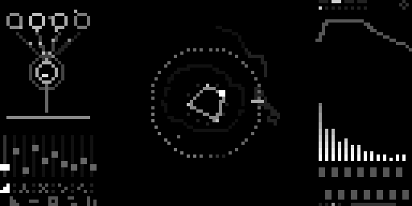

[English](README.md) · [Español](README.es.md) · [Français](README.fr.md) · [Deutsch](README.de.md) · **日本語** · [中文](README.zh.md) · [हिन्दी](README.hi.md)

# Chordex Filo

Chordex ファミリーの「壊れた兄弟」。
[monome norns](https://monome.org/docs/norns/) 用の**モノフォニック・ローファイ**シンセです。
声はひとつだけ。それをメモリーから繰り返す**グレインの雲**が重なります。
コードモードではグレインひとつひとつがコードの構成音を選ぶので、
ひとつの声がばらばらにしたコードのように響きます。壊れていて、深くて、汚い音。
4 バンク × 8 プリセットで 32 音色。アルペジエーターの代わりに
**FALLA（故障）**があり、K2 を押しているあいだ何かが壊れます。


**画面がそのまま音です：**

- **左：** 声。OSC、SUB、NUBE（雲）、POLVO（ほこり）の円はレベルに応じて光り、
  フィルターへ粒子を送ります。フィルター内の点がカットオフ、リングがレゾナンス。
  下に 10 本のフェーダー。
- **中央：** 点のリングがメモリー（鳴ったところが光る）、線が現在位置、
  弧がグレインです。外側ほど高い音。内側にはドライの波形と、
  12 音のホイール上のコード。ROTO を上げると全体が階段状になり、ちらつきます。
- **右：** バンクとプリセット、オシロスコープ、スペクトラム、
  そして K2 を押しているあいだ動く故障のアニメーション。

## 特徴

- **モノ**：後着優先。レガートで弾くと再アタックせずにグライドします
- **4 バンク × 8 プリセット**
  - **ROTO**（壊れた）：MODEM、GLITCH、8 BITS、CD RAYADO、CORTO、ESQUIRLAS、
    FALLA、SIERRA
  - **ABISMO**（深淵）：FOSA、SUBSUELO、CALDERA、BALLENA、TUNEL、LODO、DRONE、
    ECLIPSE
  - **CINTA**（テープ）：VHS、CASETE、WALKMAN、BOBINA、DICTAFONO、RADIO AM、
    DERRETIDO、TECLADO
  - **NUBE**（雲）：NIEBLA、ENJAMBRE、LLOVIZNA、MAREA、ESPEJO、CORO ROTO、
    CENIZA、AURORA
- **声**：ノコギリ波からパルス波まで変化するオシレーター、サブ、
  テープのサチュレーションとワウ、エンベロープ付きレゾナント・フィルター、グライド
- **雲**：声は常に 5 秒のメモリーに録音され、グレインがそこを読みます。
  サイズ、密度、メモリー（どこまでさかのぼるか）、
  カオス（オクターブ、逆再生グレイン、乱れ、パン）
- **コードモード**：グレインがコードの 4 音からひとつを選びます。
  **10 種のコード**：maj、min、dim、aug、7、maj7、min7、m7b5、sus2、sus4
- **FALLA**（K2 長押し）、テンポ同期、4 タイプ：
  - **CAIDA**（落下）：テープが止まりかけ、ピッチが崩れ落ちて消える
  - **TARTAMUDEO**（どもり）：ヘッドが止まり、直前の小さな断片を繰り返す
  - **MORDIDA**（噛みつき）：ROTO が最大になり、テンポに合わせて音が切れる
  - **POZO**（井戸）：1 オクターブ下がり、フィルターが閉じてホールが開く
- **roto**：サンプル数とビット数を落とし、音切れを加える。
  **polvo**：ヒス、クラックル、ハム、高域の劣化。どれも音に追従します
- **エフェクト**：テンポ同期のテープエコーと暗いホール
- **ホールド**（K1）
- 受信した MIDI クロックに故障とエコーのテンポが追従
- 設定はすべて自動保存

<!-- u-ma:family -->
## Chordex ファミリー

操作は同じ、エンジンは別。ほかの楽器もどうぞ：

| | |
|---|---|
| <a href="https://github.com/buenosairesfront/chordex80/blob/main/README.ja.md"></a> | **[Chordex 80](https://github.com/buenosairesfront/chordex80/blob/main/README.ja.md)**<br>アウトランの夕焼けを描く 80 年代ポリシンセ<br>`;install https://github.com/buenosairesfront/chordex80` |
| <a href="https://github.com/buenosairesfront/chordexfm/blob/main/README.ja.md"></a> | **[Chordex FM](https://github.com/buenosairesfront/chordexfm/blob/main/README.ja.md)**<br>花として描かれる 4 オペレーター FM<br>`;install https://github.com/buenosairesfront/chordexfm` |
| <a href="https://github.com/buenosairesfront/chordexstg/blob/main/README.ja.md"></a> | **[ChordexSTG](https://github.com/buenosairesfront/chordexstg/blob/main/README.ja.md)**<br>弓で擦った弦の実際の動きを描くオーケストラ弦楽<br>`;install https://github.com/buenosairesfront/chordexstg` |
| <a href="https://github.com/buenosairesfront/chordexwt/blob/main/README.ja.md"></a> | **[Chordex WT](https://github.com/buenosairesfront/chordexwt/blob/main/README.ja.md)**<br>8 波形 × 8 バンクのウェーブテーブル。3D テーブルとして描画<br>`;install https://github.com/buenosairesfront/chordexwt` |
| <a href="https://github.com/buenosairesfront/chordexchip/blob/main/README.ja.md"></a> | **[Chordex CHIP](https://github.com/buenosairesfront/chordexchip/blob/main/README.ja.md)**<br>チップチューン：ゲーム機チップ 8 種 × 8 プリセット、トラッカーとして描画<br>`;install https://github.com/buenosairesfront/chordexchip` |
| <a href="https://github.com/buenosairesfront/chordexabnt/blob/main/README.ja.md"></a> | **[Chordex ABNT](https://github.com/buenosairesfront/chordexabnt/blob/main/README.ja.md)**<br>パッド、アンビエント、リード、テクスチャー：4 ファミリー × 8 プリセット、アルペジエーターの代わりにムーブメント<br>`;install https://github.com/buenosairesfront/chordexabnt` |

**U-MA のほかの作品：** すべての楽器とツールをひとつに → [U-MA ショーケース](https://github.com/buenosairesfront/U-ma/blob/main/README.ja.md)
<!-- /u-ma:family -->

## 必要なもの

- norns（shield、standard、fates）
- MIDI キーボードまたはコントローラー

## インストール

maiden で：

```
;install https://github.com/buenosairesfront/chordexfilo
```

その後 **norns を再起動**（SYSTEM > RESTART）して新しいエンジン `Filo` を
コンパイルし、SELECT から **chordexfilo** を読み込みます。

## 操作

| 操作 | 動作 |
|---|---|
| E1 | カットオフ（明るさ） |
| E2 | フェーダーを選ぶ（名前が一瞬表示されます） |
| E3 | フェーダーを調整 |
| K3 + E1 | プリセット（32 個が一列：ROTO 1–8、ABISMO、CINTA、NUBE） |
| K3 + E2 | ホール |
| K3 + E3 | コードの種類 |
| K3 長押し（回さずに） | コードモード オン/オフ |
| K2 長押し | 故障（押しているあいだだけ） |
| K2 + E1 | 故障の深さ |
| K2 + E2 | 故障のタイプ |
| K2 + E3 | 故障の速さ（1/2 〜 1/32） |
| K1 長押し | ホールド オン/オフ（右上のひし形） |

**フェーダー：** アタック、リリース、レゾナンス、グレインサイズ、密度、メモリー、
カオス、roto（壊れ）、polvo（ほこり）、エコー。

**PARAMETERS メニュー：** MIDI チャンネル（初期値 1、0 = すべて）、バンク、
プリセット、波形（ノコギリ〜パルス）、サブ、グライド、オクターブ、ワウ、
サチュレーション、雲（ドライ〜グレイン）、ディケイ、サステイン、
フィルター・エンベロープ、エコーのフィードバックとタイム、音量、および上記すべて。

## arc と crow

どちらも任意です。arc や crow をつないでいなければ何も変わりません。

**arc**（4 リング、ノブとして表示）：1 カットオフ · 2 グレインサイズ · 3 故障の深さ · 4 ホール

**crow**：IN1 = ピッチ（V/oct、0 V = C4）、IN2 = ゲート（発音とリリース） · OUT1 = ノート（V/oct） · OUT2 = エンベロープ（0–8 V、音のアタックとリリースに連動） · OUT3 = テンポ同期 LFO · OUT4 = ノートごとのパルス。PARAMETERS > ARC / CROW でオフにできます。

**テンポ：** 初回起動時は内部テンポが 50 BPM になります。MIDI クロックが（どの MIDI ポートからでも）入ると、そちらが優先されます。

## ギャラリー

| | |
|---|---|
|  ROTO · MODEM · maj7 |  ABISMO · FOSA · min7 |
|  CINTA · VHS · maj7 |  NUBE · NIEBLA · min |
|  故障 TARTAMUDEO（K2 長押し） |  プリセット選択（K3 + E1） |

## クレジット

制作：[Buenos Aires Front](https://github.com/buenosairesfront) / U-MA。
MIT ライセンスで公開。
