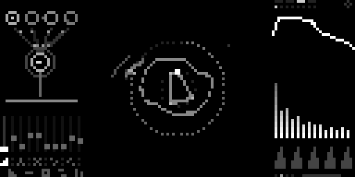

**English** · [Español](README.es.md) · [Français](README.fr.md) · [Deutsch](README.de.md) · [日本語](README.ja.md) · [中文](README.zh.md) · [हिन्दी](README.hi.md)

# Chordex Filo

The broken sibling of the Chordex family: a **monophonic lo-fi** synth for
[monome norns](https://monome.org/docs/norns/). A single voice and a **cloud
of grains** that repeats it from memory. In chord mode each grain picks one
note of the chord: one voice that sounds like a chord taken apart. Broken,
deep and dirty, with 4 banks × 8 presets — 32 sounds. Instead of an
arpeggiator it has **FALLA** (failure): while you hold K2, something breaks.


**The screen is the sound:**

- **left:** the voice. OSC, SUB, NUBE (cloud) and POLVO (dust) are circles
  whose brightness is their level; they send particles into the filter. The
  dot inside the filter is the cutoff and the ring is the resonance. Below,
  the 10 faders.
- **center:** the ring of dots is the memory (what just sounded glows), the
  tick marks the present and the arcs are the grains: further out = higher.
  Inside, the dry waveform and the chord on a 12-note wheel. With ROTO
  everything turns stepped and flickers.
- **right:** bank and preset, oscilloscope, spectrum and the failure,
  animated while K2 is held.

## Features

- **mono**: last-note priority. Playing legato, the voice glides without
  re-attacking
- **4 banks × 8 presets**
  - **ROTO** (broken): MODEM, GLITCH, 8 BITS, CD RAYADO, CORTO, ESQUIRLAS,
    FALLA, SIERRA
  - **ABISMO** (abyss): FOSA, SUBSUELO, CALDERA, BALLENA, TUNEL, LODO, DRONE,
    ECLIPSE
  - **CINTA** (tape): VHS, CASETE, WALKMAN, BOBINA, DICTAFONO, RADIO AM,
    DERRETIDO, TECLADO
  - **NUBE** (cloud): NIEBLA, ENJAMBRE, LLOVIZNA, MAREA, ESPEJO, CORO ROTO,
    CENIZA, AURORA
- **voice**: one oscillator that goes from saw to pulse, sub, tape
  saturation and wow, resonant filter with envelope, glide
- **cloud**: the voice is recorded all the time into a 5-second memory and
  the grains read from it. Size, density, memory (how far back they look)
  and chaos (octaves, reversed grains, disorder, panning)
- **chord mode**: each grain picks one of the four notes of the chord.
  **10 chords**: maj, min, dim, aug, 7, maj7, min7, m7b5, sus2, sus4
- **FALLA** (hold K2), tempo-synced, 4 types:
  - **CAIDA** (fall): the tape slows down, the pitch collapses and it dies
  - **TARTAMUDEO** (stutter): the head stops and repeats the last little bit
  - **MORDIDA** (bite): fully broken, with tempo-synced cuts
  - **POZO** (pit): an octave down, the filter closes and the hall opens
- **roto**: fewer samples, fewer bits and dropouts. **polvo**: hiss,
  crackle, hum and treble loss, all following the sound
- **effects**: tempo-synced tape echo and a dark hall
- **hold** (K1)
- follows incoming MIDI clock for the failure and echo tempo
- all settings are saved automatically

<!-- u-ma:family -->
## The Chordex family

Same controls, different engines. Try the others:

| | |
|---|---|
| <a href="https://github.com/buenosairesfront/chordex80"></a> | **[Chordex 80](https://github.com/buenosairesfront/chordex80)**<br>'80s polysynth with an outrun sunset<br>`;install https://github.com/buenosairesfront/chordex80` |
| <a href="https://github.com/buenosairesfront/chordexfm"></a> | **[Chordex FM](https://github.com/buenosairesfront/chordexfm)**<br>4-operator FM, drawn as a flower<br>`;install https://github.com/buenosairesfront/chordexfm` |
| <a href="https://github.com/buenosairesfront/chordexstg"></a> | **[ChordexSTG](https://github.com/buenosairesfront/chordexstg)**<br>orchestral strings with real bowed-string motion<br>`;install https://github.com/buenosairesfront/chordexstg` |
| <a href="https://github.com/buenosairesfront/chordexwt"></a> | **[Chordex WT](https://github.com/buenosairesfront/chordexwt)**<br>wavetable: 8 banks of 8 waves, drawn as a 3D table<br>`;install https://github.com/buenosairesfront/chordexwt` |
| <a href="https://github.com/buenosairesfront/chordexchip"></a> | **[Chordex CHIP](https://github.com/buenosairesfront/chordexchip)**<br>chiptune: 8 console chips × 8 presets, drawn as a tracker<br>`;install https://github.com/buenosairesfront/chordexchip` |
| <a href="https://github.com/buenosairesfront/chordexabnt"></a> | **[Chordex ABNT](https://github.com/buenosairesfront/chordexabnt)**<br>pads, ambient, leads and textures: 4 families × 8 presets, with MOTION instead of an arpeggiator<br>`;install https://github.com/buenosairesfront/chordexabnt` |

**More from U-MA:** every instrument and tool in one place → [U-MA showcase](https://github.com/buenosairesfront/U-ma)
<!-- /u-ma:family -->

## Requirements

- norns (shield, standard or fates)
- a MIDI keyboard or controller

## Install

From maiden:

```
;install https://github.com/buenosairesfront/chordexfilo
```

Then **restart norns** (SYSTEM > RESTART) so the new `Filo` engine compiles,
and load **chordexfilo** from SELECT.

## Controls

| control | action |
|---|---|
| E1 | cutoff (brightness) |
| E2 | select fader (its name shows for a moment) |
| E3 | adjust fader |
| K3 + E1 | preset (all 32 in a row: ROTO 1–8, ABISMO, CINTA, NUBE) |
| K3 + E2 | hall |
| K3 + E3 | chord type |
| hold K3 (without turning) | chord mode on/off |
| hold K2 | failure (lasts while held) |
| K2 + E1 | failure depth |
| K2 + E2 | failure type |
| K2 + E3 | failure rate (1/2 to 1/32) |
| hold K1 | hold on/off (diamond, top right) |

**Faders:** attack, release, resonance, grain size, density, memory, chaos,
roto (broken), polvo (dust), echo.

**PARAMETERS menu:** MIDI channel (1 by default; 0 = all), bank, preset,
shape (saw–pulse), sub, glide, octave, wow, saturation, cloud (dry–grains),
decay, sustain, filter envelope, echo feedback and time, volume, plus
everything above.

## arc and crow

Both are optional: with no arc or crow connected nothing changes.

**arc** (4 rings, drawn as knobs): 1 cutoff · 2 grain size · 3 failure depth · 4 hall

**crow**: IN1 = pitch (V/oct, 0 V = C4), IN2 = gate (plays and releases) · OUT1 = the note (V/oct) · OUT2 = envelope (0–8 V, with the sound's attack and release) · OUT3 = tempo-synced LFO · OUT4 = a pulse on every note. It can be turned off in PARAMETERS > ARC / CROW.

**Tempo:** on first run the internal tempo starts at 50 BPM. If MIDI clock comes in (on any MIDI port), it takes over.

## Gallery

| | |
|---|---|
|  ROTO · MODEM · maj7 |  ABISMO · FOSA · min7 |
|  CINTA · VHS · maj7 |  NUBE · NIEBLA · min |
|  TARTAMUDEO failure (K2 held) |  choosing a preset (K3 + E1) |

## Credits

Made by [Buenos Aires Front](https://github.com/buenosairesfront) / U-MA.
Released under the MIT license.
